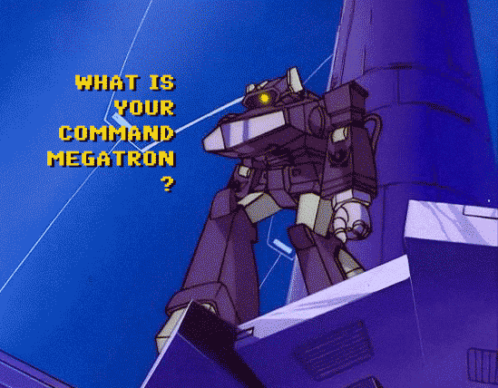

# Shockwave
Local-first Windows voice dictation. Start and stop with `Ctrl + Space`, the floating radar, or a Vosk wake word. Text is copied to the clipboard; `paste` can send `Ctrl+V` to the focused input.

## Recognition
- **RU:** GigaAM (`gigaam-v3-e2e-rnnt`) through ONNX Runtime.
- **ML:** Parakeet (`nemo-parakeet-tdt-0.6b-v3`) or Whisper (`large-v3-turbo`) through `faster-whisper`.
- **Wake word:** English or Russian Vosk model selected under `[Wake]`.
- Models load on demand. ONNX recordings split at pauses when Silero VAD is available; otherwise the full recording is processed.

## Modes

| Checkbox | What it does |
| --- | --- |
| `LLM norm` | Fix punctuation and terminology |
| `to EN` | Translate into English |
| `clip+` | Add dictation above existing clipboard text |
| `wake` | Listen for the wake word |
| `alert` | Play notification sounds |
| `paste` | Paste into the focused input |
| `AI task` | Turn speech into an AI prompt |
| `Idea` | Structure thoughts into a draft |
| `mk Post` | Write a social media post |

`AI task`, `Idea`, and `mk Post` are mutually exclusive. LLM modes use OpenAI-compatible endpoints and editable prompts in `config/prompts/`. `glossary.txt` applies replacements before LLM processing. Use `RU`/`ML` buttons to select the speech model.

## Quick start
1. Download [`Shockwave-v1.3.0-Windows-x64.zip`](https://github.com/dzamwave/shockwave/releases/tag/1.3.0) and extract it.
2. Edit `config\config.ini`, using `config\config.example.ini` as a reference.
3. Run `Shockwave.exe` or `Start-Shockwave.bat`; answer `y` when Shockwave asks to download missing GigaAM, ML, or VAD assets.
4. Press `Ctrl + Space` or click the radar to dictate. Speech weights are downloaded into `models/`; no weights, personal configuration, or API keys are included in the repository or release archive.

## Configuration and security
Main sections are `[Recording]`, `[Recognition]`, `[Wake]`, `[Text]`, `[LLM]`, `[LLM Normalize]`, `[Prompts]`, `[Widget]`, `[Sound]`, and `[Console]`. External LLM endpoints require HTTPS; HTTP is allowed only on loopback, and redirects are rejected.

See the [English setup guide](docs/shockwave_setup_guide_eng.md) and the [1.3.0 GitHub release](https://github.com/dzamwave/shockwave/releases/tag/1.3.0).

